# Digital Invitation Platform (Pakistan & Overseas): Master Product Specification & UX/UI Architecture

---

## 1. Global Benchmark & Shoulder Niche Intelligence

To build a category-defining product, we synthesized the best UX patterns from global tier-1 platforms and adjacent event industries:

```
┌─────────────────────┬────────────────────────────────────────────┬────────────────────────────────────────────────────────┐
│ Global Platform     │ Core UX Strength                           │ How We Adapt It for Pakistan                           │
├─────────────────────┼────────────────────────────────────────────┼────────────────────────────────────────────────────────┤
│ Paperless Post      │ Skeuomorphic tactile envelope opening      │ Replace envelopes with 3D Silk Ribbons, Wax Seals,    │
│                     │ & digital wax seals                        │ and Carved Palace Doors with sound effects             │
│ WithJoy (Joy)       │ Household grouping & multi-event gating    │ Group families as 1 unit (e.g. "Chacha + 4 heads")     │
│                     │ (guests only see events they are invited to│ Walima-only guests never see Mehndi details            │
│ Greenvelope         │ Automated RSVP reminders via SMS/Email     │ Automated WhatsApp 48-hr reminder helper               │
│ Bliss & Bone        │ High-end editorial typography & video loop │ Royal Nastaliq typography + cinematic teaser films     │
│ Eventbrite / Luma   │ QR code ticketing & gate check-in app      │ Gatekeeper QR Pass to prevent banquet gatecrashers     │
└─────────────────────┴────────────────────────────────────────────┴────────────────────────────────────────────────────────┘
```

### Shoulder Niches to Dominate (Year-Round Revenue Beyond Wedding Season):
Pakistani weddings peak between October and March. To maintain year-round high-margin revenue, the platform architecture will natively support:
1. **Aqiqah & Baby Announcements:** (Boy: Blue & Gold Crescent; Girl: Pink & Motia Floral). Focus: Baby name reveal + Dua requests.
2. **Milestone Birthdays:** (1st Birthday "Guriya/Shehzada", 16th/18th, 50th Golden Jubilee).
3. **Spiritual & Religious Gatherings:** Khatam-e-Quran, Roza Kushai, Milad-un-Nabi, Hajj/Umrah Mubarak reception.
4. **Qawwali & Musical Soirées:** Separate niche for modern pre-wedding youth nights.
5. **Corporate Galas & Product Launches:** B2B tier with high-volume guest QR scanning, VIP seat tiers, and brand sponsorships.

---

## 2. Ultra-Simple "No-Brainer" UX/UI Design (Tailored for Pakistan)

### The Psychological Context of the Pakistani User:
* **The Buyer (The Host/Couple):** Usually the bride, groom, or tech-savvy sibling (20–34 years old). They want luxury aesthetics without filling tedious 30-field forms.
* **The End-User (The Relatives / Guests):** Often uncles, aunties, and elders (45–70 years old) on budget smartphones, often with lower literacy or unfamiliarity with complex web apps.
* **Non-Negotiable Rules:**
  1. **Zero Reading Required:** Every button must have an icon, high contrast, and bilingual Roman Urdu / Urdu text (*"Yahan Dabayein" / "یہاں دبائیں"*).
  2. **Zero Login for Guests:** Guests must NEVER be asked to register, install an app, or enter an OTP to view their card or RSVP.
  3. **3-Second Loading Limit:** Compressed assets, lazy-loaded fonts, WebP/AVIF graphics, and CDN caching to open seamlessly on slow 4G/3G mobile data.
  4. **The "Grandmother Test":** If a 65-year-old grandmother cannot find the venue map with a single thumb-tap, the UI has failed.

---

## 3. The End-to-End User Journeys

```mermaid
flowchart TD
    subgraph Host_Journey ["1. The Host / Couple Journey (Creating the Invitation)"]
        Ad["Meta/TikTok Video Ad"] --> Home["Aesthetic Mobile Landing Page"]
        Home -->|Step 1: Pick Style| Catalog["Visual Carousel (1-Tap Theme Select)"]
        Catalog -->|Step 2: 2 Questions Only| MicroInput["Enter Names (Groom & Bride)"]
        MicroInput -->|Instant Magic| LivePreview["Instant Live Interactive Preview (Watermarked)"]
        LivePreview -->|Step 3: Add Functions| EventDetails["Tap to Pick Events (Mehndi, Barat, Walima)"]
        EventDetails -->|Google Maps Search| AutoVenues["Type Hall Name (Auto-fetches Map Pin)"]
        AutoVenues -->|Instant Checkout| OneTapPay["1-Tap JazzCash / Easypaisa / Card Payment"]
        OneTapPay --> Publish["Live Card + Host Control Center"]
    end

    subgraph Guest_Journey ["2. The Wedding Guest Journey (Opening the Invitation)"]
        WhatsAppMsg["Receives WhatsApp Invitation Message"] -->|Taps Link| CardOpen["Opens Instantly in Browser (No App)"]
        CardOpen --> Unveil["Interactive Unveiling (Untie Ribbon / Break Wax Seal)"]
        Unveil --> AmbientMusic["Soft Shehnai / Traditional Music Plays"]
        AmbientMusic --> EventSchedule["Clean Event Itinerary (Dates, Timings, Hijri)"]
        EventSchedule --> MapAction["Big Gold Button: 'Get Directions (Google Maps)'"]
        EventSchedule --> CalAction["'Add to Phone Calendar' (1-Tap Sync)"]
        EventSchedule --> RSVPAction["Big Green Button: 'Will You Attend? (RSVP)'"]
        RSVPAction --> RSVPModal["Household Selector: Attending (Yes/No) + Headcount"]
        RSVPModal --> SalamiAction["Optional: 'Send Salami & Duas' (Raast QR Tray)"]
        SalamiAction --> WishesAction["Post a Blessing on the Couple's Wall"]
    end
```



---

## 4. Comprehensive Deliverables Portfolio

You will deliver everything competitors offer PLUS the critical missing pieces:

```
┌──────────────────────────────────────┬────────────────────────────────────────────────────────────────────────┐
│ Deliverable Category                 │ Detailed Deliverable Specifications                                    │
├──────────────────────────────────────┼────────────────────────────────────────────────────────────────────────┤
│ 1. The Interactive Web Invitation    │ • Hosted on your custom subdomain (e.g. `hamza-ayesha.dawatna.pk`)     │
│                                      │ • 3D interactive entrance (Ribbon untie, wax seal break, door knock)   │
│                                      │ • Dual English & Nastaliq Urdu toggle button                           │
│                                      │ • Ambient background music player with mute/unmute floating disc       │
│                                      │ • Google Maps venue direction buttons with exact hall pins             │
│                                      │ • Live countdown clock + Add to Apple/Google Calendar                  │
│                                      │ • Dress code guide per function (e.g. Yellow/Green for Mehndi)         │
│                                      │ • Photo memory gallery (6 to 15 photos) + optional pre-wedding film   │
├──────────────────────────────────────┼────────────────────────────────────────────────────────────────────────┤
│ 2. WhatsApp Distribution Pack        │ • Vertical 9:16 MP4 animated teaser video for WhatsApp Status          │
│                                      │ • High-resolution static PNG/JPEG invitation flyer (square & vertical) │
│                                      │ • Pre-formatted WhatsApp copy snippet (ready to forward with emojis)   │
│                                      │ • 1-Click WhatsApp Direct Share buttons                                │
├──────────────────────────────────────┼────────────────────────────────────────────────────────────────────────┤
│ 3. Personalized Guest Links Engine   │ • Individualized dynamic links (`/g/chacha-tariq-family`)              │
│                                      │ • Personalized hero greeting: "Dear Chacha Tariq & Family"             │
│                                      │ • Seat allocation badge: "We have reserved 4 seats in your honor"      │
│                                      │ • Event-gated privacy: Guests only see events they are invited to       │
├──────────────────────────────────────┼────────────────────────────────────────────────────────────────────────┤
│ 4. Digital Salami & Gift Registry    │ • Digital Salami Tray: Host's Raast ID / QR Code / Bank IBAN           │
│                                      │ • Overseas Gifting: Direct digital cash gift via Stripe/Credit Card    │
│                                      │ • Personalized heartfelt congratulatory note attached to gifts         │
├──────────────────────────────────────┼────────────────────────────────────────────────────────────────────────┤
│ 5. Banquet Entry Pass & QR Security  │ • Unique security QR code generated on each private guest link         │
│                                      │ • Gatekeeper Web Scanner: Hall bouncer/usher scans QR code on phone    │
│                                      │ • Verifies guest authenticity & shows verified headcount at entrance   │
├──────────────────────────────────────┼────────────────────────────────────────────────────────────────────────┤
│ 6. Host Control Center (Dashboard)   │ • Real-time confirmed guest headcount tracker (Adults vs Children)     │
│                                      │ • Meal preferences tally (Chicken / Mutton / Veg / Diet) for caterer   │
│                                      │ • Guest Wishes moderation approval wall                                │
│                                      │ • 1-Click Excel / CSV export for banquet management                    │
│                                      │ • Real-time visitor view count & engagement analytics                  │
├──────────────────────────────────────┼────────────────────────────────────────────────────────────────────────┤
│ 7. Post-Wedding Memory Vault         │ • Card does NOT expire: Turns into a permanent wedding memory page     │
│                                      │ • Guest Photo Drop: Relatives can upload raw photos they took at event│
└──────────────────────────────────────┴────────────────────────────────────────────────────────────────────────┘
```

---

## 5. Website Architecture & Site Map

```
YourPlatform.pk
├── / (Homepage — High-converting, video-first landing page)
├── /designs (Filterable catalog: Wedding, Mehndi, Walima, Aqiqah, Birthday, Corporate)
├── /preview/[design-slug] (Interactive full-screen preview with demo names)
├── /studio (The frictionless 3-step invitation creator)
├── /checkout (Automated 1-tap local wallets + card payment)
├── /dashboard (Host control center for RSVPs, guest list, and link generator)
│   ├── /dashboard/guests (Guest roster, allocated seats, private link copier)
│   ├── /dashboard/rsvps (Live confirmed attendees, meal preferences, CSV export)
│   ├── /dashboard/wishes (Moderate prayers and messages)
│   ├── /dashboard/salami (View Salami blessings log)
│   └── /dashboard/scanner (Gatekeeper mobile QR code check-in scanner)
├── /invite/[couple-slug] (General public invitation webpage)
├── /g/[guest-token] (Personalized private guest invitation webpage)
└── /blog (Hyper-local SEO guides: Wedding wording, venue guides, etiquette)
```

---

## 6. The 4 Product Tiers (High-Conversion Packaging)

```
┌───────────────────────────────────┬───────────────────────────────────┬───────────────────────────────────┬───────────────────────────────────┐
│ TIER 1: BASIT (LITE)              │ TIER 2: SHAHANA (SIGNATURE)       │ TIER 3: SHAHI (ROYAL BESPOKE)     │ TIER 4: CORPORATE / GALA          │
│ Rs. 1,499 (One-Time)              │ Rs. 3,999 (Most Popular)          │ Rs. 8,999 (The VIP Experience)    │ Rs. 19,999 (B2B Events)           │
├───────────────────────────────────┼───────────────────────────────────┼───────────────────────────────────┼───────────────────────────────────┤
│ • 1 General Web Invitation Link   │ • 1 General Link + 100 Private    │ • Unlimited Private Guest Links   │ • Multi-tier ticket / badge links │
│ • Up to 3 Events (e.g. Mehndi,    │   Personalized Guest Links        │ • Bespoke Theme & Palette Tuning  │ • Speaker / Sponsor / Agenda tabs │
│   Barat, Walima)                  │ • 3D Interactive Entrance (Ribbon,│ • Cinematic Couple Video Embed    │ • Gatekeeper QR Scanner App (web) │
│ • Google Maps + 1-Tap Calendar    │   Wax Seal, or Diya Touch)        │ • Digital Salami / Raast Cash Tray│ • Real-time Check-in Analytics    │
│ • Urdu & English Bilingual Toggle │ • English + Proper Nastaliq Urdu  │ • Photo Gallery (Up to 15 photos) │ • Custom Corporate Domain         │
│ • WhatsApp 1-Tap RSVP Button      │ • Background Music Engine         │ • Table Seating Planner           │ • WhatsApp Broadcast Dispatcher   │
│ • 9:16 WhatsApp Status MP4 Video  │ • Web RSVP Form + Meal Choices    │ • Gatekeeper QR Entry Passes      │ • VIP WhatsApp Support Desk       │
│ • Static HD Image Flyer (PNG)     │ • Guest Wishes Wall (Moderated)   │ • WhatsApp Batch Dispatch Helper  │ • Full Excel Attendee Reports     │
│ • 6 Months Active Hosting         │ • Guest List Excel / CSV Export   │ • Lifetime Memory Vault Archive   │ • Invoiced Corporate Billing      │
│                                   │ • 1 Year Active Hosting           │ • 100% Done-For-You VIP Setup     │                                   │
└───────────────────────────────────┴───────────────────────────────────┴───────────────────────────────────┴───────────────────────────────────┘
```
