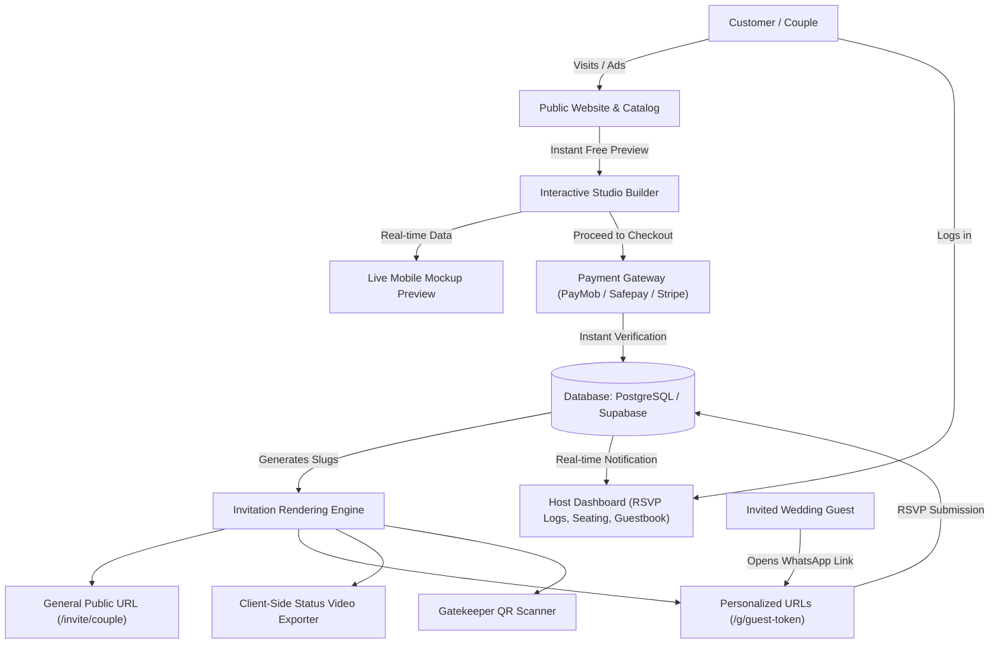

# Pakistani Digital Wedding & Event Invitations Market: Master Intelligence Report & Go-To-Market Blueprint

---

## 1. Executive Summary & Market Landscape

The Pakistani wedding stationery market is undergoing an aggressive generational transition from traditional printed shadi cards to **interactive digital wedding invitations (online shadi cards)** distributed primarily through **WhatsApp**. 

### The Macro Economics of the Problem:
1. **Printed Cards:** Cost between Rs. 15,000 to Rs. 80,000+ for 300–600 cards, take 2–3 weeks to print, have spelling and date risks that cannot be rectified, require physical dispatch (fuel, courier, relatives' homes), and still end up with relatives asking for venue location pins on WhatsApp.
2. **Current Digital Stopgaps:** Simple Canva JPEGs or low-res screen recordings look cheap, lack Google Maps navigation, lack countdowns, have no RSVP tracking, and get compressed to illegibility on WhatsApp.
3. **The Web-Link Invitation (The Winning Paradigm):** A dedicated interactive mobile-first webpage that opens smoothly inside WhatsApp or any mobile browser without app downloads, featuring interactive opening animations (curtains untying, wax seals breaking, diyas lighting), background music, bilingual Nastaliq Urdu/English text, Google Maps integration, 1-tap calendar sync, and individualized private guest links.

---

## 2. In-Depth Dissection of All 7 Competitors in the Archive

Below is an exhaustive breakdown of every competitor in the `E-INVITATIONS` folder:

```
┌─────────────────────────┬──────────────────────────────┬────────────────────────────┬─────────────────────────────┐
│ Competitor              │ Primary Model                │ Price Range (PKR)          │ Turnaround / Fulfillment    │
├─────────────────────────┼──────────────────────────────┼────────────────────────────┼─────────────────────────────┤
│ 1. ceremoniainvites.com │ Automated SaaS + VIP Concierge│ Rs. 5,000 – Rs. 15,000     │ Instant preview / 1 hr live │
│ 2. dawatlink.com        │ Micro-transaction Budget SaaS│ Rs. 100 – Rs. 500          │ Instant automated (browser) │
│ 3. dawatnama.app        │ SaaS (Tayyab Tech, Karachi)  │ Rs. 0 – Rs. 5,999          │ Instant / 15-min onboard    │
│ 4. dawatnama.store      │ Studio Boutique (Karachi)    │ Rs. 3,999 – Rs. 25,000+    │ Live demo / Same day        │
│ 5. niru.pk              │ Luxury Design Studio (Lahore)│ Rs. 5,900 – Rs. 19,490+    │ 24–48 hrs draft / 50% split │
│ 6. osinvites.com        │ WhatsApp Direct Agency       │ Rs. 1,000 – Rs. 5,999      │ Manual WhatsApp delivery    │
│ 7. sehra.pk             │ Studio Platform with Trial   │ Rs. 2,000 – Rs. 5,500      │ 3-Day Free Trial / Instant  │
└─────────────────────────┴──────────────────────────────┴────────────────────────────┴─────────────────────────────┘
```

---

### Competitor 1: Ceremonia Invites (`ceremoniainvites.com`)

* **Origin & Entity:** Based in Lahore, Pakistan. Founder / Account Title: *Hafiz Muhammad Ahmad Bhatti*. Contact WhatsApp: `+92 301 4544411`. Email: `support@ceremoniainvites.com`. Instagram: `@ceremoniainvites`.
* **Business Model:** Self-serve template builder with optional VIP concierge setup.
* **Pricing & Packages:**
  * **Base Invitation Plan:** Rs. 5,000 to Rs. 8,000 (regular price crossed out Rs. 8,000 to Rs. 12,500; premium design *Rewind* is Rs. 10,500 / Rs. 15,000). Includes full card, 1 link for all events, plus individual event links (`/mehndi`, `/baraat`, `/walima`).
  * **Invitation + Guest List Plan:** Rs. 8,000 to Rs. 10,000 (adds unlimited private guest links addressed with guest names and seat counts).
  * **Add-on: "Set it up for me":** +Rs. 2,500 (Customer sends details on WhatsApp; team populates everything).
  * **Custom Domain Connection:** Free / included (user buys domain, Ceremonia connects DNS).
* **Payment Rails & Flow:**
  * Bank Transfer (United Bank Limited - UBL, A/C: 0112310637376, IBAN: `PK86UNIL0109000310637376`).
  * JazzCash (`03014544411`).
  * Easypaisa (`03014544411`).
  * *Verification:* Manual. Customer uploads screenshot of transaction or types Transaction ID (TID) alongside WhatsApp number and chosen password. Account verified and activated on WhatsApp within ~1 hour.
* **User Journey (`TryFlow`):**
  1. User clicks "Try it free with your names".
  2. Modal opens with 3 rapid questions:
     - Step 1: Couple/Star names (Groom full & first name, Bride full & first name, Parents' names).
     - Step 2: Events & Dates (Mehndi, Barat, Walima, Nikkah, Birthday, etc.).
     - Step 3: Contact (WhatsApp number + country selector, Email, Password).
  3. Interactive card renders live in browser with real data.
  4. User can upgrade/pay to publish and remove preview restrictions.
* **Deliverables:**
  * Live responsive webpage hosted on `ceremoniainvites.com/<slug>` (or connected custom domain).
  * Individual event sub-URLs (`/mehndi`, `/baraat`, `/walima`).
  * Private guest links (`/g/<guest-slug>`) greeting guest by name and showing reserved seats.
  * Access to Host Dashboard.
* **Templates Catalog:**
  * *Mehru* (Curtain unties, film plays for each function - Rs. 8,000)
  * *Mehru Returns* (Gold curtain, moonlit pavilion, film for each function - Rs. 8,000)
  * *Rewind* (90s wedding on nostalgic VHS tape with play buttons - Rs. 10,500)
  * *The Everlasting Stitch* (Linen curtain unties onto fairytale castle, embroidered pearls/roses - Rs. 8,000)
  * *Bazm e Shahi* (Sandstone and gold royal palace - Rs. 8,000)
  * *Dastaan e Wisaal* (Taj Mahal from sunrise to moonlight - Rs. 8,000)
  * *Bazm-e-Ghulab* (Burgundy 3D 4-flap fold, wax seal, grand floral arch - Rs. 5,000)
  * *Madina Journey / Madina Journey 2* (Prophet’s Mosque umbrella canopies opening onto Madina - Rs. 5,000 / Rs. 8,000)
  * *Makkah Journey* (Kaaba / spiritual journey - Rs. 8,000)
  * *Elegant Wedding*, *Jashan-e-Bahara*, *A Royal Beginning*, *Ehd-e-Muhabbat*, *Royal Maroon*, *Lavish Wedding Theme*, *Dastaan*, *Doctor's Theme*, *Princess Birthday*, *Confetti*, *Time Portal Pals* (Rs. 5,000 – Rs. 8,000).
* **Key Features:**
  * Film/video backgrounds playing wedding footage.
  * 3D wax seals, untying bows, opening gatefolds.
  * Dual language toggle (English & Nastaliq Urdu).
  * Unlimited events.
  * Google Maps venue button.
  * Live countdown timer.
  * Contact tap-to-call / WhatsApp cards for RSVPs.
  * Host dashboard for real-time text/venue editing.

---

### Competitor 2: DawatLink (`dawatlink.com`)

* **Origin & Entity:** Operated by *Faisal Hussain IT Services*, Islamabad, Pakistan. Support WhatsApp: `+92 326 8710114`.
* **Business Model:** Ultra-budget micro-transaction volume SaaS ("Card nahi, poori dawat"). Lowest price in the market.
* **Pricing & Packages:**
  * **Web Invite:** Rs. 100 (One-time)
    - Animated invitation link (`dawatlink.com/dawat/<slug>`).
    - Up to 3 events with Google Maps buttons.
    - Countdown timer & Add-to-Calendar.
    - WhatsApp RSVP button.
    - PNG Image download.
    - 1 post-payment edit included.
  * **Link + Video (Recommended):** Rs. 300 (One-time)
    - Everything in Web Invite.
    - Vertical 9:16 MP4 animated video for WhatsApp Status (rendered client-side on user's phone).
    - 1 post-payment edit included.
  * **Premium:** Rs. 500 (One-time)
    - Everything in Link + Video.
    - Interactive RSVP form + private guest list with headcount tracker & CSV export.
    - 3 post-payment edits included.
* **Payment Rails & Flow:**
  * Easypaisa IBAN / JazzCash / Bank transfer.
  * User inputs the sender account name on the order page. System matches and auto-activates once confirmed.
  * 24-Hour delivery refund guarantee if unverified.
* **Deliverables:**
  * Web link live for at least 12 months.
  * Vertical 9:16 MP4 status video for WhatsApp.
  * High-res PNG static image card.
  * CSV spreadsheet export of RSVPs (Premium).
* **Templates Catalog (35 animated designs):**
  * *Royal Maroon*, *Emerald Nikah*, *Mehndi Marigold*, *Walima Blush*, *Midnight Lanterns*, *Birthday Pink*, *Birthday Blue*, *Aqiqah Moon*, *Truck Art Phool*, *Phulkari Rang*, *Dholki Nights*, *Peacock Darbar*, etc.
* **Key Features:**
  * Zero signup required to create full animated preview with "PREVIEW" watermark.
  * Client-side video generation (browser creates 9:16 MP4 without cloud render costs).
  * Nastaliq Urdu and English typing.
  * Religious header selector: *Bismillah*, *Bismihi Ta‘ala*, *786*, or *None*.
  * Up to 3 events per card.

---

### Competitor 3: DawatNama App (`dawatnama.app`)

* **Origin & Entity:** Tayyab Technologies, Karachi, Pakistan. Facebook ID: `61586480843043`. Instagram: `@dawatnama.app`.
* **Business Model:** SaaS model with Free Freemium Tier + Premium/Royal one-time upgrades.
* **Pricing & Packages:**
  * **Free Plan:** PKR 0
    - 1 event only, 50 guests limit, 3 basic templates, basic RSVP tracking, 30 days active.
  * **Premium Plan:** PKR 2,999 (one-time)
    - Unlimited events, unlimited guests, all 20+ templates, meal preferences in RSVP, Our Story & Photo Gallery, CSV/Excel guest import, DawatNama branding removed, 6 months active.
  * **Royal Plan:** PKR 5,999 (one-time)
    - Everything in Premium, exclusive royal templates, video header support, table/seating arrangement tool, priority WhatsApp support, 15-minute onboarding call, exportable analytics reports, 1 year active.
* **User Journey & Dashboard:**
  * Onboarding questionnaire (5 rapid questions starting with groom's name).
  * Full user authentication (Email/Password, phone number).
  * User Dashboard: Real-time analytics (views, shares, RSVP responses), guestbook moderation, table seating manager.
* **Deliverables:**
  * Responsive web invitation link.
  * Excel/CSV attendee exports.
  * Seating chart export.
* **Key Features:**
  * Guestbook & Wishes wall (guests leave blessings).
  * Meal preference collection (Biryani, Qorma, Vegetarian, etc.).
  * Seating arrangement module.
  * Video header background.
  * Real-time visitor view analytics.

---

### Competitor 4: DawatNama Store (`dawatnama.store`)

* **Origin & Entity:** Physical studio at *Bahria Complex 1, M.T. Khan Road, Karachi, Pakistan*. WhatsApp: `0327 3760566`. Email: `support@dawatnama.store`. TikTok: `@dawat_nama`. Instagram: `@dawa.tnama`.
* **Business Model:** Boutique Design Studio combining ready-made template sales with high-end bespoke custom orders.
* **Pricing & Packages:**
  * **The Card (Base):** Rs. 3,999 (e.g. Taj Mahal video) to Rs. 4,999. Includes 1 public link, up to 4 events, music, maps, countdown, 3 months hosting.
  * **Card + Private Guest Links Add-on:**
    - Pack of 30 Private Links: +Rs. 1,500
    - Pack of 120 Private Links: +Rs. 3,000
    - Unlimited Private Links: +Rs. 5,000
  * **Concierge Setup Add-on:** +Rs. 1,500 (Send details on WhatsApp, team inputs everything).
  * **Hosting Extension:** +Rs. 1,500 for an extra 3 months.
  * **Bespoke / Custom Designed from Scratch:** Starting from Rs. 25,000 to Rs. 45,000+ (Quoted per brief).
* **Deliverables:**
  * Responsive webpage live for 3 months.
  * Private link packs greeting each guest by name and allocating headcounts.
  * WhatsApp-ready sharing snippets.
* **Templates Catalog:**
  * *Taj Mahal* (Video arch: sunrise, lanterns, moon - Rs. 3,999)
  * *Elegant Wedding*, *Royal Maroon*, *Jashan-e-Bahara*, *Sehra*, *Lavish Wedding Theme*, *Chandni*, *Noor*, *Naqsh*, *Jashan*, *Guriya* (Rs. 4,999).
* **Content & SEO Strategy:**
  * Has over 50 hyper-localized SEO landing pages targeting affluent Pakistani neighborhoods (e.g., *Bahria Town Lahore, DHA Islamabad, F-7 Islamabad, Gulberg Lahore, Model Town Lahore, Clifton Karachi, Saddar Rawalpindi*).

---

### Competitor 5: Niru (`niru.pk`)

* **Origin & Entity:** Luxury Design Studio based in Lahore, Pakistan. WhatsApp: `+92 321 3397889`. Email: `support@niru.pk`. Instagram: `@studio.niru`.
* **Business Model:** High-touch artisanal design studio. Differentiates on emotional storytelling, cultural craft, and bespoke art.
* **Pricing & Packages:**
  * **Template Editions (Pre-built designs with client info):**
    - *Signature (Essential Interactive):* PKR 5,900 (First preview in 24–48 hours, up to 5 revision rounds).
    - *Premium (Complete Experience):* PKR 8,400 (First preview in 2–3 days, unlimited revisions, adds Story Timeline & Guest Summary).
    - *Atelier (Cinematic Experience):* PKR 12,490 (Includes custom couple film woven into interactive entrance).
  * **Personalised Editions (Bespoke visual identity created from scratch):**
    - *Signature Bespoke:* PKR 8,900
    - *Premium Bespoke:* PKR 12,400
    - *Atelier Bespoke:* PKR 19,490
  * **Add-ons:**
    - Separate guest-list card (e.g. Walima-only or Nikah-only link): PKR 1,500 each.
    - Custom Subdomain (`couple-names.niru.pk`): PKR 1,000.
  * **Payment Split:** 50% advance to start, 50% upon draft approval (huge trust builder in Pakistan). Accepts Bank Transfer, Easypaisa, and SadaPay.
* **Deliverables:**
  * Interactive webpage hosted for a full 12 months.
  * Private live RSVP Google/web response sheet.
  * Custom subdomain.
* **Templates & Entrance Interactions:**
  * *Dilkusha* / *Roshni* (Press and hold the diya)
  * *Neelum* / *Haveli* (Swing the lantern)
  * *Chinar* (Hand embroidery needlecraft)
  * *Dehleez* (Knock three times on carved wooden gates)
  * *Sahar* / *Baradari* / *Moti Bagh* (Draw the silk cloth aside, wax seal break)
* **Key Features:**
  * Scratch-to-reveal wedding date.
  * Tactile interactive entrance mechanics (knock 3 times, hold diya).
  * Guest wishes wall with moderation.
  * Photo gallery & Story timeline.
  * Dress code suggestions per function.

---

### Competitor 6: OS Invites (`osinvites.com`)

* **Origin & Entity:** Operated via Karachi/Online. WhatsApp: `+92 330 3954244`. Instagram: `@osinvites`.
* **Business Model:** Hybrid agency selling static image cards, animated video invites, and webpage invitations entirely via WhatsApp ordering.
* **Pricing & Products:**
  1. **Static Invitations:** Rs. 1,000 (16 designs: ST-01 to ST-16). Single JPG/PNG graphic.
  2. **Pre-Designed Video:** Rs. 1,500. HD MP4 video with music.
  3. **Customizable Video:** Rs. 2,800. Fully customized animations and text.
  4. **Dynamic Wedding Webpages:** Rs. 5,999 (was Rs. 10,000). 8 designs (*Wedding Traditional, Taj Mahal, Green Palace, Mega Fantasy, The Royal Palace, Blue Breeze, Pinkflow Tradition, Prestige Flower*).
* **Deliverables:**
  * High-res PNG/JPG for static cards.
  * MP4 video files for video invites.
  * Web link with 3 months hosting.
* **Features:**
  * WhatsApp-first: Clicking "Order on WhatsApp" triggers a pre-filled WhatsApp message with the product code.

---

### Competitor 7: Sehra (`sehra.pk`)

* **Origin & Entity:** The most expansive catalog in the market. Contact WhatsApp: `+92 329 8389084`. Instagram: `@sehra.pkofficial`.
* **Business Model:** Self-service SaaS platform with a **3-Day Free Trial** (users can build the entire card and test it before paying).
* **Pricing & Packages:**
  * **Sada:** Rs 2,000 (Online for 2 months)
    - Any house theme, 1 entrance animation, English + Urdu text, up to 4 events with Google Maps & Calendar sync, countdown & background audio.
  * **Shahana (Most Chosen):** Rs 3,500 (Online for 4 months)
    - Everything in Sada + Custom colour palette & monogram, couple story & journey timeline, photo gallery (up to 6 photos), guest wishes wall with moderation.
  * **Shahi (Royal Tier):** Rs 5,500 (Online for 5 months)
    - Everything in Shahana + Bespoke artwork & typography, custom entrance interaction, couple film/video embed, curated photo gallery (up to 10 photos).
* **Catalog Scale:**
  * **83 Themes:** 25 Royal & Heritage, 25 Floral & Crafts, 7 Mehndi & Festive, 5 Nikah & Spiritual, 21 Modern & Editorial. Cultural designs include *Ajrak Heritage, Chikankari, Royal Zardozi, Pashmina Tilla, Sheesh Mahal, Motia Jasmine, Phulkari, Truck Art*.
  * **54 Interactive Openings:** 3D Rose letter, Satin keepsake, Blooming gates, Diya thaal, Palace doors, Silk bow untie, Wax seal melt, Knock the door, Part the curtain, Scratch to reveal, Painted storybook, Royal farmaan, etc.
* **Key Features:**
  * Studio builder with instant live mobile frame preview.
  * Custom slug (`sehra.pk/i?slug=username`).
  * Full audio engine with play/mute controls.
  * RSVP tracking and guest message wall.

---

## 3. Master Merged Feature Inventory

Below is every feature offered across all 7 competitors, categorized systematically:

### A. Entrance & Unveiling Mechanics
1. **Interactive Gestures:** Tap/Click to open, Press-and-hold (e.g. diya/lantern), Knock three times on palace gates, Drag/Swipe cloth or curtain aside, Untie 3D silk ribbon, Break/melt 3D wax seal, Scratch-to-reveal hidden dates.
2. **Visual Opening Styles:** Royal gatefold doors, 3D 4-flap origami unfold, Royal farmaan scroll unrolling, Storybook page turn, Nostalgic VHS tape insert & play, Cinematic curtain parting, Rose petal & pearl rain drop.

### B. Wedding & Event Structure
1. **Multi-Event Hierarchy:** Separate tabs/cards for *Dholki, Mayun, Mehndi, Qawwali Night, Nikkah, Baraat, Walima, Shalima, Reception, Baat Pakki, Engagement*.
2. **Religious & Cultural Top-Notes:** Choice of Islamic blessings (*Bismillah ar-Rahman ar-Rahim*, *Bismihi Ta‘ala*, *786*, Quranic marriage verses like Surah Ar-Rum 30:21, Durood, or None for interfaith/secular events).
3. **Event Metadata:** Hijri Islamic date alongside Gregorian date, Day of week, Reception timings, Dinner timings, Rukhsati timing, Nikah solemnization time.
4. **Venue Navigation:** Direct Google Maps pin integration, Waze / Apple Maps directions, Exact hall name, gate number, and parking instructions.
5. **Calendar Integration:** 1-tap "Add to Calendar" (.ics file download and Google Calendar web link).
6. **Live Countdown:** Real-time ticking timer (Days, Hours, Minutes, Seconds) to each event.

### C. Language & Typography
1. **True Nastaliq Urdu Script:** Proper right-to-left Nastaliq typography (not broken Arabic fonts) for traditional elders.
2. **1-Tap Language Switcher:** Interactive toggle allowing the guest to switch between English and Urdu instantly.
3. **Bilingual Fields:** Enter names, parentage (*S/o*, *D/o*), invitations (*Minjanib*, *Chashm-e-Baraah*), and venue details in both languages simultaneously.

### D. Audio & Multimedia
1. **Background Soundtrack:** Traditional instrumentals (Shehnai, Sitar, Flute), Islamic Nasheeds, Sufi Qawwali, Lo-fi acoustic music, or custom MP3 upload by couple.
2. **Audio Controls:** Floating ambient mute/unmute button with browser auto-play policy compliance (starts on first user interaction/tap).
3. **Cinematic Couple Video:** Embedded YouTube, Vimeo, or HTML5 MP4 player for save-the-date teaser or pre-wedding highlights film.
4. **Photo Gallery:** Grid or swipeable carousel of 6 to 12 curated couple/family photos with zoom lightbox.
5. **Our Story Timeline:** Milestone timeline ("How we met", "The proposal", "The baat pakki").

### E. Guest Personalization & Access Control
1. **Private Guest Links:** Dedicated dynamic URLs (`/g/uncle-tariq-family`) that greet the specific guest by name on the cover.
2. **Seat / Headcount Allocation:** Shows exact reserved seats ("4 seats held for you and your family").
3. **Event-Gated Invitations:** Restricts functions so guests only see the events they are invited to (e.g. Walima-only guests do not see Mehndi details).
4. **General Link:** Fallback public link for broad WhatsApp groups.
5. **Custom Subdomains / Domains:** Branded web address (`hamza-ayesha.com` or `hamza-ayesha.niru.pk`).

### F. RSVP & Guest Management
1. **1-Tap WhatsApp RSVP:** Button opens pre-filled WhatsApp message back to the host's phone with name, attendance status, and guest count.
2. **Web RSVP Form:** Clean form on the page collecting: Attending / Regret, Number of attendees, Guest names, Dietary/Meal preferences (Chicken / Mutton / Veg / Diet).
3. **Host Dashboard RSVP Log:** Live dashboard showing confirmed headcounts, pending responses, and regrets.
4. **CSV/Excel Export:** Downloadable attendee roster for caterers and venue seating.
5. **Guest Wishes Wall / Guestbook:** Digital message board where friends and overseas relatives post prayers and congratulations, with host approval moderation.

### G. Formats & Deliverables
1. **Interactive Webpage:** Full responsive mobile-first website hosted securely on CDN.
2. **Vertical Video (9:16 MP4):** Short animated video clip formatted for WhatsApp Status and Instagram Stories.
3. **Static Image Card (PNG/JPG):** High-resolution digital flyer for printing or fast messaging.
4. **Shareable WhatsApp Copy Snippet:** Pre-written invitation text with emojis, dates, and link ready to copy-paste into WhatsApp.

---

## 4. Critical Gaps & Unexploited Market Opportunities

Current competitors have left major operational and commercial blind spots. By solving these, you can leapfrog existing players:

```
┌──────────────────────────────────────┬────────────────────────────────────────────────────────┬────────────────────────────────────────────────────────┐
│ Area                                 │ What Competitors Are Doing (The Flaw)                  │ Your Opportunity / Unfair Advantage                    │
├──────────────────────────────────────┼────────────────────────────────────────────────────────┼────────────────────────────────────────────────────────┤
│ 1. Payment Friction                  │ Manual bank transfer; screenshot upload; 1-hr wait     │ Instant 1-tap checkout (PayMob / Kuickpay / Card)      │
│ 2. WhatsApp Distribution             │ Couple manually forwards link to 400 contacts one by one│ Automated WhatsApp Batch Sender / Cloud API Dispatch   │
│ 3. Automated RSVP Chasing            │ Couple has to phone relatives who haven't replied      │ Automated WhatsApp 48-hr RSVP reminder bot             │
│ 4. Digital Salami / E-Shagun         │ Completely missing across all 7 sites                  │ Integrated Raast / Bank QR code for digital cash gifts │
│ 5. Hall Security / QR Check-in       │ None; anyone with link can walk in                     │ Unique QR code per guest pass + gatekeeper scanner web │
│ 6. Expiration Trap                   │ Links die after 2 to 3 months unless extra fee paid    │ Permanent "Memory Archive" with photo uploads post-wed │
│ 7. Overseas / NRI Monetization       │ Hardcoded in PKR; overseas credit cards decline        │ USD/GBP/AED Stripe checkout with multi-timezone clocks │
│ 8. Dual Family Dashboard             │ Single login; bride and groom sides fight over edits   │ Multi-admin bride's side vs groom's side guest lists   │
└──────────────────────────────────────┴────────────────────────────────────────────────────────┴────────────────────────────────────────────────────────┘
```

### Detailed Breakdown of The Gaps:

1. **Zero Real-Time Automated Payments:**
   Almost all competitors (Ceremonia, Sehra, Dawatnama Store) require customers to manually open their banking app, transfer funds to an individual's personal UBL/JazzCash account, take a screenshot, upload it to the website, and wait up to an hour for manual verification on WhatsApp. This causes severe checkout abandonment, especially late at night when couples do wedding planning.
   * *Your Solution:* Integrate **PayMob, Safepay, or Kuickpay** for instant local checkout (JazzCash, Easypaisa, Debit/Credit Card) + **Stripe** for overseas Pakistanis, activating the card in under 3 seconds automatically.

2. **The "WhatsApp Forwarding Nightmare" (The Biggest Unsolved Pain):**
   Even after getting a digital invitation link, the host still has to sit and manually send 250 individual WhatsApp messages to different family members and aunties.
   * *Your Solution:* Offer a **WhatsApp Web Automated Broadcast Tool** or WhatsApp Business API integration that personalizes and queues messages for 1-click sending right from the browser.

3. **No Digital Salami / E-Shagun / Cash Gift Module:**
   In Pakistani culture, guests give *Salami* (cash envelopes). For overseas guests or modern weddings, carrying cash envelopes to banquets is cumbersome. Not a single competitor has an elegant digital Salami feature.
   * *Your Solution:* Add an optional "Salami / Blessings" tray with the couple’s Raast QR code, IBAN, or digital wallet link where guests can send monetary blessings directly with a personalized note.

4. **Lack of Gatekeeper QR Code Verification:**
   High-end banquets in Karachi, Lahore, and Islamabad suffer from uninvited gatecrashers or security issues.
   * *Your Solution:* With every private guest link, generate a unique, non-duplicable **Entry QR Code**. Provide the couple with a simple mobile scanning page for their gatekeeper to check guests in and verify allocated seats.

5. **Arbitrary Link Expiration & Lack of Memory Preservation:**
   Competitors cut off hosting after 2 to 4 months unless the user pays Rs. 1,500 extra. Couples hate having their wedding invitation vanish.
   * *Your Solution:* Offer lifetime storage. After the wedding date passes, automatically transform the invitation link into a **"Wedding Memories & Photo Album"** where guests can upload raw photos they took at the wedding!

---

## 5. Winning Product Architecture & Pricing Strategy

To capture both the mass market and the high-ticket luxury segment, adopt a **3-Tiered Hybrid Model**:

```
                         THE WINNING OFFERING

     [ TIER 1: BASIT (LITE) ]        [ TIER 2: SHAHANA (CORE) ]        [ TIER 3: SHAHI (LUXURY) ]
          Rs. 1,499 one-time             Rs. 3,999 one-time                Rs. 8,999 one-time
     ────────────────────────       ───────────────────────────       ────────────────────────────
     • 1 General WhatsApp Link      • 1 General + 100 Private Links   • Unlimited Private Guest Links
     • Up to 3 Events               • All Functions Included          • Bespoke Theme & Palette
     • Google Maps + Calendar       • 3D Interactive Opening          • Cinematic Couple Video Embed
     • Live Countdown Timer         • English + Nastaliq Urdu         • Digital Salami / Raast Tray
     • Urdu & English Text          • Background Music                • Photo Gallery (15 photos)
     • 1-Tap WhatsApp RSVP Button   • Web RSVP Form + Meal Choices    • Seating Planner + QR Entry Pass
     • 9:16 WhatsApp Status Video   • Wishes Wall with Moderation     • WhatsApp Batch Dispatch Helper
     • 6 Months Hosting             • Guest List CSV Export           • Lifetime Hosting & Memory Vault
                                    • 1 Year Hosting                  • VIP WhatsApp Concierge Setup
```

### High-Margin Add-Ons:
* **"Done-For-You Concierge Setup":** +Rs. 1,500 (Customer sends text/dates on WhatsApp, your team enters it).
* **Additional 50 Private Guest Links:** +Rs. 1,000.
* **Custom Domain (`hamza-ayesha.com`):** +Rs. 3,500.
* **Overseas Pricing:** \$29 (Basit) / \$49 (Shahana) / \$99 (Shahi) via Stripe.

---

## 6. Website System & Technical Architecture to Build

### Frontend & Tech Stack
* **Framework:** Next.js 14+ (App Router) or Vite + React with Tailwind CSS.
* **Styling & Animation:** Tailwind CSS, Framer Motion (for smooth 3D unfolding, envelope unsealing, ribbon untying), HTML5 Canvas for interactive scratch-to-reveal dates and confetti bursts.
* **Audio Engine:** Howler.js managing background music playback with auto-play policy fallback ("Tap anywhere to begin music").
* **Typography:** Embedded Google Fonts: `Noto Nastaliq Urdu` / `Jameel Noori Nastaleeq` for Urdu; `Playfair Display`, `Cinzel`, `Cormorant Garamond` for royal English serif headers.

### System Architecture Diagram


### Database Schema Core Entities (PostgreSQL / Supabase):
1. `Users` (id, email, phone, role, created_at)
2. `Invitations` (id, user_id, slug, template_id, couple_names, religious_header, urdu_enabled, music_url, video_url, custom_domain, status, tier)
3. `Events` (id, invitation_id, title_en, title_ur, date, start_time, end_time, venue_name, venue_address, google_maps_url)
4. `Guests` (id, invitation_id, guest_token, name, phone, allocated_seats, allowed_event_ids, rsvp_status, attended_count, dietary_preference, qr_code_hash)
5. `Wishes` (id, invitation_id, author_name, message, approved)
6. `Orders` (id, user_id, invitation_id, amount, currency, gateway, transaction_id, status)

---

## 7. Go-To-Market & Advertising Strategy (Pakistan Specific)

### A. Meta Ads (Instagram & Facebook) — The Core Customer Acquisition Engine
Pakistani wedding decisions are driven primarily by the **Bride, Groom, and Sisters of the Groom/Bride** aged 22–34.
* **Campaign Angle 1 (The Emotional / Aesthetic Hook):** Video of a phone screen with a finger untying a silk ribbon or breaking a 3D wax seal to reveal the couple's invitation while soft shehnai music plays. Caption: *"Printed shadi cards are so 2015. Get your living digital dawatnama with venue maps, RSVP & music on WhatsApp."*
* **Campaign Angle 2 (The Relatable Pain Point Hook):** Comedy skit or problem demonstration: *"When relatives call you at 10 PM asking for the banquet location pin... Send them a live Dawat link with 1-tap Google Maps directions."*
* **Targeting:** Interests: *Weddings, Bridal wear, Sabyasachi, Maria B, Sania Maskatiya, Nikkah, Barat*. Locations: *Karachi, Lahore, Islamabad/Rawalpindi, Faisalabad, Multan, Peshawar, plus overseas UAE, UK, USA*.

### B. TikTok Ads & Influencer Seeding
* Partner with bridal makeup artists, wedding photographers, and wedding venue halls.
* Offer free custom luxury invitations to high-profile micro-influencers getting engaged or married in exchange for a TikTok/Reels screen recording: *"Look how we sent our wedding invitations on WhatsApp!"*

### C. Search Engine Optimization (SEO)
Replicate the local neighborhood programmatic landing page strategy discovered in `dawatnama.store`:
* Target transactional keywords: `online shadi card pakistan`, `digital wedding invitation urdu`, `whatsapp shadi card maker`, `wedding card price in lahore`, `wedding invitation card bahria town karachi`.
* Publish downloadable Urdu wedding invitation wording templates (*"Dawat-e-Walima Urdu wording formats"*).

---

## 8. Step-by-Step Implementation Roadmap to Go Live

```
┌──────────────────────────────────────┬────────────────────────────────────────────────────────┐
│ Phase                                │ Key Milestones & Actions                               │
├──────────────────────────────────────┼────────────────────────────────────────────────────────┤
│ Phase 1: Core Engine & Templates     │ • Develop Next.js responsive invitation framework      │
│ (Days 1 – 10)                        │ • Build 6 killer cultural templates (Mughal, Modern,   │
│                                      │   Chikankari, Ajrak, Royal Maroon, Emerald Nikah)      │
│                                      │ • Code 3 interactive opening animations (Wax seal,     │
│                                      │   Curtain untie, Diya touch) + Urdu Nastaliq font engine│
├──────────────────────────────────────┼────────────────────────────────────────────────────────┤
│ Phase 2: Studio Builder & Checkout   │ • Build rapid 3-question preview studio                │
│ (Days 11 – 18)                       │ • Integrate PayMob / Safepay for local cards/wallets   │
│                                      │ • Integrate Stripe for overseas USD orders             │
│                                      │ • Set up automated transactional WhatsApp confirmation │
├──────────────────────────────────────┼────────────────────────────────────────────────────────┤
│ Phase 3: Dashboard & Differentiation │ • Build Host Dashboard with live RSVP tracking         │
│ (Days 19 – 25)                       │ • Add Private Guest Link generator + CSV export        │
│                                      │ • Add Digital Salami Raast QR code widget              │
│                                      │ • Build Gatekeeper Entry QR Code scanner               │
├──────────────────────────────────────┼────────────────────────────────────────────────────────┤
│ Phase 4: Launch & Paid Acquisition   │ • Launch high-converting landing page                  │
│ (Days 26 – 30)                       │ • Turn on Meta & TikTok video ads                      │
│                                      │ • Activate wedding vendor referral network             │
└──────────────────────────────────────┴────────────────────────────────────────────────────────┘
```
