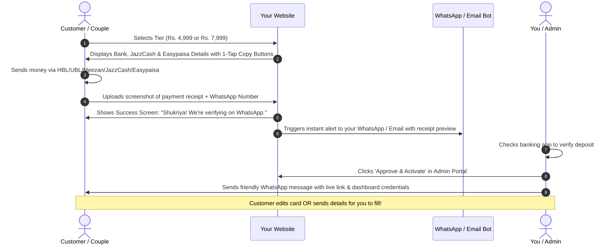

# Custom Platform Blueprint & Launch Architecture: Digital Invitations (Pakistan)

---

## 1. Business & Pricing Model (Finalized Structure)

Your platform operates on a high-converting, high-trust **2-Tier Structure** tailored for the Pakistani wedding economy:

```
┌───────────────────────────────────────────────┬───────────────────────────────────────────────┐
│ TIER 1: STANDARD EDITION                      │ TIER 2: ROYAL ALL-INCLUSIVE EDITION           │
│ Rs. 4,999 (One-Time)                          │ Rs. 7,999 (Most Popular / Best Value)         │
├───────────────────────────────────────────────┼───────────────────────────────────────────────┤
│ • Interactive Web Invitation Link             │ • All Premium Web Invitation Templates        │
│ • Full access to standard cultural themes     │ • 3D Interactive Entrances (Silk Ribbon bow,  │
│ • Up to 3 Events (e.g. Mehndi, Barat, Walima) │   Wax seal break, Palace gates, Diya touch)   │
│ • Google Maps venue directions button         │ • Vertical 9:16 Animated WhatsApp Video (MP4) │
│ • 1-Tap Add to Calendar (Apple & Google)      │ • High-Resolution Static Image Flyer (PNG)    │
│ • Dynamic live countdown clock                │ • Full Guest Management & RSVP Dashboard      │
│ • Bilingual English + Nastaliq Urdu toggle    │ • Unlimited Private Personalized Guest Links   │
│ • Ambient background music player             │ • Seat allocation badge ("3 seats reserved")  │
│ • WhatsApp 1-tap RSVP button                  │ • Event-gated privacy (Walima guests only see │
│ • High-Resolution WhatsApp Status Photo (PNG) │   Walima, hiding other private events)        │
│ • Standard customer edit access               │ • Web RSVP Form with Meal Preferences         │
│ • 6 Months Active Hosting                     │ • Guest Wishes Wall with host moderation      │
│                                               │ • 1-Click Excel / CSV Guest List Export       │
│                                               │ • Digital Salami / Raast Cash Tray            │
│                                               │ • Banquet Gatekeeper QR Pass & Web Scanner    │
│                                               │ • 1 Year Active Hosting + Memory Vault        │
│                                               │ • VIP WhatsApp Concierge Setup Support        │
└───────────────────────────────────────────────┴───────────────────────────────────────────────┘
```

---

## 2. Frictionless Manual Payment & Fulfillment Workflow

Pakistani consumers have high distrust of auto-debit cards, but are very comfortable with **bank app transfers, JazzCash, and Easypaisa**. 



### The 3 Steps on Checkout Page:
1. **Step 1: Copy Account Details (Zero Typing Error):**
   * Bank Name: Meezan Bank / UBL / HBL / Bank Alfalah
   * Account Title: `[Your Full Name / Business Title]`
   * Account Number: `0102XXXXXXXXXX` `[Copy Button]`
   * IBAN: `PKXXMEZN000000XXXXXXXXXX` `[Copy Button]`
   * JazzCash: `03XXXXXXXXX` `[Copy Button]`
   * Easypaisa: `03XXXXXXXXX` `[Copy Button]`
2. **Step 2: Upload Proof:**
   * File dropzone: *"Take a screenshot of the confirmation screen in your bank app and upload here"* (accepts JPG, PNG, PDF up to 10MB).
   * Optional text input: *"Or enter Transaction ID (TID)"*.
3. **Step 3: Contact & Access:**
   * Customer Name
   * Customer WhatsApp Number (e.g. `0300 1234567`)
   * Password (so they can log in to their dashboard once approved).

---

## 3. Instant Admin Notification & 1-Click Verification System

When a customer submits a receipt, your system immediately triggers:
1. **WhatsApp Webhook / Telegram Bot Alert to Your Phone:**
   > 🔔 **New Order Received!**
   > * Package: Royal All-Inclusive (Rs. 7,999)
   > * Couple: Hamza & Ayesha
   > * WhatsApp: +92 300 1234567
   > * Receipt: [View Screenshot Link]
   > * 1-Click Action: [Approve & Message on WhatsApp]
2. **Admin Portal (`/admin`):**
   * Order queue with thumbnail of the receipt screenshot.
   * Button 1: **"Verify & Activate"** (Changes order status to `PAID`, removes the preview watermark, and unlocks the customer's dashboard).
   * Button 2: **"Open WhatsApp Chat"** (Pre-fills a message to the customer's phone number).

### WhatsApp Greeting Message Templates:
* **Template A (For Self-Serve):**
  > *"Assalam-o-Alaikum Hamza bhai! Humey aapki Rs. 7,999 ki payment mil gayi hai. Aapka Royal Invitation Card live ho chuka hai! Aap yahan login kar ke changes kar saktay hain: [Dashboard Link]. Agar koi bhi madad chahiye ho, hum WhatsApp par available hain!"*
* **Template B (For VIP Setup Concierge):**
  > *"Assalam-o-Alaikum! Humey aapki payment receive ho gayi hai. Agar aap chahein to hum aapka card khud set up kar dete hain! Bas events ke dates, timings aur venue location pins yahan send kar dein. Hum 2 ghantay mein ready kar ke link bhejte hain."*

---

## 4. Technical Architecture: Next.js 14 + Tailwind + Supabase

```
                     TECH STACK SPECIFICATION
┌───────────────────┬────────────────────────────────────────────────────────┐
│ Layer             │ Technologies Used                                      │
├───────────────────┼────────────────────────────────────────────────────────┤
│ Framework         │ Next.js 14 (App Router) + TypeScript                   │
│ Styling           │ Tailwind CSS + Shadcn UI components                    │
│ 3D Animations     │ Framer Motion (Ribbon unwrap, wax seal break, gates)   │
│ Canvas Effects    │ HTML5 Canvas (`canvas-confetti` + scratch-off reveal)  │
│ Audio Engine      │ Howler.js (Auto-play policy compliant with mute disc)  │
│ Database & Auth   │ Supabase (PostgreSQL) + Row Level Security (RLS)       │
│ Image Storage     │ Supabase Storage / Cloudflare R2 (Receipts & Photos)   │
│ WhatsApp Dispatch │ Twilio WhatsApp API / GreenAPI / UltraMsg Webhook      │
│ Video Generator   │ Client-side Canvas Recorder / Remotion (9:16 MP4)      │
│ Deployment & CDN  │ Vercel + Cloudflare DNS (Lightning fast in Pakistan)   │
└───────────────────┴────────────────────────────────────────────────────────┘
```

---

## 5. UI/UX Wireframe & Design Rules (Pakistani Context)

1. **The 2-Field Magic Bar (Homepage Hero):**
   * Top of homepage features an interactive smartphone mockup.
   * Input box 1: *Dulha ka Naam* (e.g. "Ahmed").
   * Input box 2: *Dulhan ka Naam* (e.g. "Fatima").
   * Big Gold Button: *"Apna Card Dekhein"* (See My Card).
   * Card instantly renders with their names. Zero account creation required.
2. **Venue Pin Locator:**
   * Instead of asking users to type coordinates, use Google Places Autocomplete: they type "Pearl Continental Karachi" and the pin, address, and map link are automatically locked.
3. **Bilingual Switcher:**
   * Floating pill button at the top: `[English | اردو]`.
   * Displays proper Nastaliq calligraphy for Urdu readers.

---

## 6. Deliverables Specification & Formats

1. **Interactive Web Invitation:**
   * Unique link: `dawatna.pk/invite/ahmed-fatima` or custom subdomain `ahmed-fatima.dawatna.pk`.
2. **Private Guest Links (Tier 2):**
   * Unique token link: `dawatna.pk/g/uncle-salman-family`.
   * Greeted with: *"Dear Uncle Salman & Family, you are warmly invited..."*
   * Shows: *"4 seats reserved in your honor"*.
3. **9:16 WhatsApp Status Video (Tier 2):**
   * Resolution: 1080x1920 MP4, 15–20 seconds duration.
   * Compressed to ~8MB (well under WhatsApp's 16MB status video limit).
4. **Static Invitation Cards (Both Tiers):**
   * Vertical 1080x1920 PNG + Square 1080x1080 PNG for Instagram feed & printing.
5. **WhatsApp Forwarding Text Block:**
   * Ready-made message with dates, venue links, and polite Urdu/English invitation phrases.
6. **Banquet Gatekeeper QR Pass (Tier 2):**
   * Scannable QR code on each guest link + web scanning page for venue security.
7. **Digital Salami Tray (Tier 2):**
   * Raast QR code / IBAN tray allowing guests to send monetary blessings.
8. **Memory Vault (Post-Wedding):**
   * Card automatically turns into a collaborative photo album after the event date.
